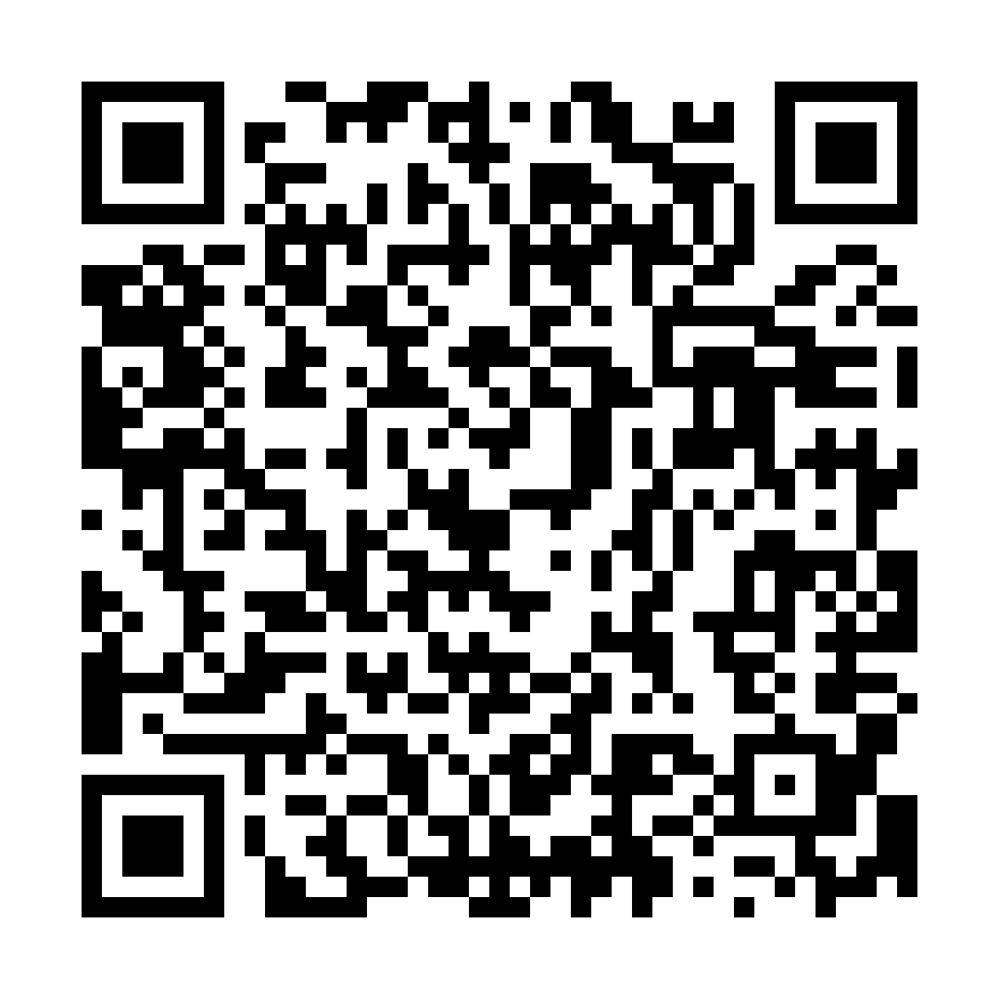

# AR Menu — proof of concept

Scan the QR code with a phone, pick a dish and tap **View on your table**. The
dish appears on your table at its real size. Walk around it and lean in.

| Dish | Real size |
| --- | --- |
| Chocolate ring cake | 26 cm across, 11 cm tall, on a 32 cm plate |
| Tiramisu | a layered slice in a 16 cm tray, 7 cm tall (AI-generated model) |
| Pumpkin gnocchi | 23 cm bowl, 7 cm tall to the top of the food (AI-generated from photos of the real dish) |

Each dish has its own link: `…/ar-menu-poc/#cake`, `…/ar-menu-poc/#tiramisu`, `…/ar-menu-poc/#gnocchi`.

**Live:** https://pmtchakanyuka-star.github.io/ar-menu-poc/



## How it works

| Piece | What it is |
| --- | --- |
| `index.html` | The menu page. One tab per dish (the `DISHES` list in the script). It uses Google's [`<model-viewer>`](https://modelviewer.dev) for the 3D preview and the AR hand-off. `ar-scale="fixed"` locks each dish to its real size. |
| `models/*.glb` | glTF 2.0 models for the web preview and Android: WebXR in Chrome, with Scene Viewer as the fallback. |
| `models/*.usdz` | USDZ models for iPhone and iPad (AR Quick Look). |
| `models/*-thumb.webp` | Menu tab pictures: renders of the models. |
| `tools/calib/detect_edges.py` | Finds the plate rim, the edge of the glaze pool and the cake's top outline in the reference photo. |
| `tools/calib/fit_camera.py` | Fits a camera and the cake's profile to those edges, plus a few hand-measured points on the hole and base, then scales the result so the base is 26 cm. |
| `tools/build_cake.py` | Builds the shape and projects the photo onto it as texture. Writes both model files. |
| `tools/build_ai_model.py` | Turns an AI-generated 3D model (Higgsfield → Tripo H3.1, downloaded into the git-ignored `tools/ai/`) into a menu model: real size, welded and decimated to 130k triangles, a fresh UV atlas with the full-detail texture baked onto it, matte food. Writes both model files. Used for the gnocchi and the tiramisu. |
| `media/hero.*` | The looping hero clip (Higgsfield Seedance from a photo of the gnocchi at the café, WebM + MP4, ~0.2 MB) and its poster. It starts only after the first dish has loaded, never with reduced motion or data saver, and has a pause button. |
| `tools/build_tiramisu.py` | The earlier, photo-built tiramisu (no longer used on the menu). |
| `tools/build_gnocchi.py` | The earlier gnocchi: fits a camera to the overhead photo and textures a height field with it (no longer used on the menu). |
| `tools/model_io.py` | The glTF and USDZ writers both builders share. |
| `tools/preview.html` | Dev-only full-window render of one model (`?src=tiramisu`). |
| `tools/make_qr.py` | Writes `qr.png` / `qr.svg`. |

### The model is made from one photo

1. **Shape.** A pinhole camera and the cake's profile are fitted to the photo. The profile runs from the pool of glaze in the hole, up the hole wall, over the rounded crest and down the flared sides to the base. The fitted edges land within a few pixels of the photo. The only real-world number supplied is the base width (26 cm, a standard ring pan); everything else comes from the photo. The glaze pool's wavy outline on the plate is back-projected from the photo too.
2. **Texture.** The photo is projected onto that shape through the fitted camera, so everything the camera saw head-on keeps its real pixels. One photo can't see everything (the back, the near wall of the hole), so those parts are filled with randomly chosen patches of the seen surface at the same height, with crossfades and no mirroring. First the photo's lighting is evened out around the cake, so patches match and the AR viewer's lights do the shading. A bump map and a roughness map come from the same pixels: glossy glaze pools, satin sprinkles.
3. **Export.** Both files are in metres and Y-up, with the origin under the plate, so AR puts the cake straight onto the table.

| | |
| --- | --- |
| Cake | 26 cm across the base, 11 cm tall (31.6 cm plate) |
| Triangles | ~101k |
| Textures | colour 2048×1024, bump 2048×1024, roughness 1024×512 (JPEG) |
| Files | `cake.glb` 4.4 MB · `cake.usdz` 3.3 MB |

Both files are validated. The Khronos glTF Validator reports 0 errors and 0 warnings, and all 28 OpenUSD validators pass for the USDZ, including the usdz packaging rules.

### The tiramisu is made from five photos

1. **Shape.** A slice with a gently domed top, soft rounded edges and cream sides that bulge and slump a little, on a black thermoformed tray with ribbed walls and a rolled rim, plus a three-leaf mint sprig. There is no real-world measurement in the photos, so the tray is the yardstick: it is about ten times as wide as it is deep, and the slice spans about 70% of its width. The sizes are constants at the top of `tools/build_tiramisu.py`.
2. **Texture.** The top is the cocoa from the straight-down photo. The sides are the slice's front face from two photos, warped flat by the four corners of the face and wrapped round, so every pixel is a real one. Where the top turns into the side, the cocoa gives way to the cream along a ragged line, as dusted cocoa does. The lighting is evened out first, and the bump and roughness maps come from the same pixels: matte cocoa, moist cream.
3. **Export.** Like the cake: metres, Y-up, origin under the tray.

| | |
| --- | --- |
| Slice | 11 × 9 cm, 4 cm tall (16 cm tray) |
| Triangles | ~113k |
| Files | `tiramisu.glb` 4.2 MB · `tiramisu.usdz` 3.1 MB |

Both files pass the same checks as the cake's: 0 glTF Validator errors or warnings, and all 28 OpenUSD validators.

### The gnocchi is textured with one overhead photo at full resolution

1. **Camera.** The bowl's white rim is found against the table in the overhead photo (680 edge points) and a pinhole camera is fitted to it, with the focal length from the photo's EXIF (24 mm on the EOS M50 II's APS-C sensor). The rim lands within 5 px. The pose is saved in `tools/gnocchi/camera.json`.
2. **Shape.** The bowl is a surface of revolution, with the profile measured from the side-on photo. There is no ruler in the photos, so it is taken as a standard 23 cm pasta bowl. The food is a height field over the bowl's floor. Solid food is told apart from the bowl by colour and from thin sauce by shape, then piled to the height the side photos show: the gnocchi top out level with the rim. The dark creases between gnocchi in the photo sink in, so each one reads as a soft pillow, and walnuts sit a little proud.
3. **Texture.** The inside of the bowl and all the food take their colour straight from the overhead photo through the fitted camera. The UVs are the projected photo pixels, so nothing is resampled more than once: a 4096 px crop, about 0.06 mm per texel. The bump and roughness maps come from the same pixels: a glossy glaze, a matte dish, since the photo's own highlights are kept.
4. **Export.** Like the others: metres, Y-up, origin under the bowl. The dish is turned so its front faces where the photo was taken from.

One photo can't see everything: the sides of gnocchi facing away from the overhead camera are stretched a little. Projecting the side photos onto those faces is the next step.

| | |
| --- | --- |
| Bowl | 23 cm across, 5.3 cm tall |
| Triangles | ~127k |
| Textures | colour 4096×4096, bump 2048×2048, roughness 1024×1024 (JPEG) |
| Files | `gnocchi.glb` 5.6 MB · `gnocchi.usdz` 4.1 MB |

## Rebuild

The reference photo isn't in the repo, because it shows more than the cake. Put it at
`tools/calib/reference.jpg`, then:

```bash
python -m venv .venv
.venv/Scripts/python -m pip install -r requirements.txt   # macOS/Linux: .venv/bin/python
.venv/Scripts/python tools/calib/detect_edges.py
.venv/Scripts/python tools/calib/fit_camera.py    # writes fit_overlay.png - check the fit by eye
.venv/Scripts/python tools/build_cake.py
.venv/Scripts/python tools/make_qr.py
```

To use a different real size, change `CAKE_BASE_DIAMETER` in `tools/calib/fit_camera.py`.

The tiramisu photos aren't in the repo either (people in the background). Put them in
`tools/tiramisu/ref/` as `front.jpg` (from the front, a little above), `corner.jpg`
(from the front left corner), `top.jpg` (straight down) and, for reference only,
`low.jpg` and `corner2.jpg`. Then:

```bash
.venv/Scripts/python tools/build_tiramisu.py
```

The photo crops it uses (the corners of each face, the top's crop) are listed at the top of the script.

For the gnocchi, put the overhead photo at `tools/gnocchi/ref/overhead.jpg` (`side.jpg` was used
only to measure the bowl's profile). Then:

```bash
.venv/Scripts/python tools/build_gnocchi.py
```

Delete `tools/gnocchi/camera.json` to refit the camera, for example with a new photo.

## From PoC to a real AR menu

- **Scan dishes instead of photographing them.** A 1–2 minute walk-around scan with Reality Composer or Object Capture (iPhone), Polycam, or Luma sees every side and measures true size. That gives a fully photo-real model with no filled-in back. The same page and QR flow work as they are.
- **Compress and serve.** Use meshopt or Draco for the GLB, KTX2 textures and a CDN.
- **One QR per table.** It opens the menu, and each dish opens in AR from there.

### The gnocchi and the tiramisu are AI-generated models

Rebuild them with:

```
.venv/Scripts/python tools/build_ai_model.py tools/ai/gnocchi.glb gnocchi --width 0.23 --glaze
.venv/Scripts/python tools/build_ai_model.py tools/ai/tiramisu.glb tiramisu --width 0.16
```

- **Gnocchi:** Higgsfield's Tripo H3.1 Multiview, from four of the photos of the real dish (front, angled, overhead, low side). Tripo models the gnocchi, walnuts and thyme all the way round, but it doesn't copy where each piece sits on the real plate.
- **Tiramisu:** an AI reference image (a layered slice in a black ribbed tray), turned into 3D with Tripo H3.1.

The extra Python packages are `trimesh`, `fast-simplification`, `xatlas` and `embreex`.
